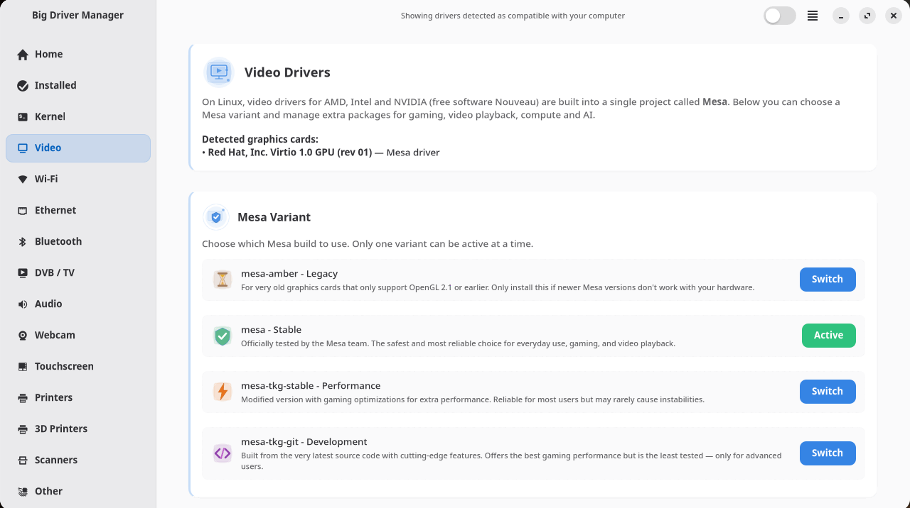
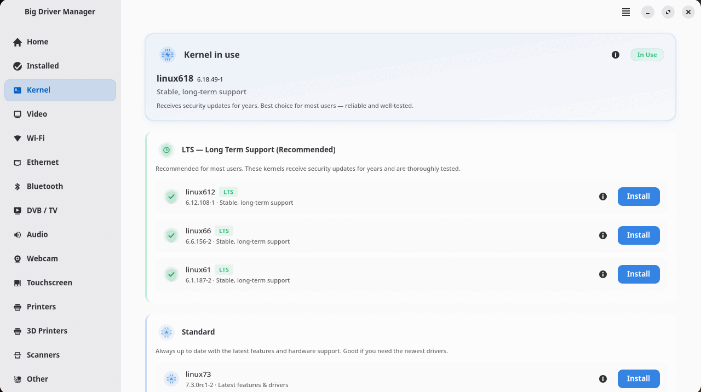
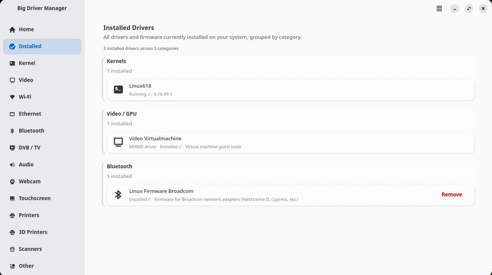
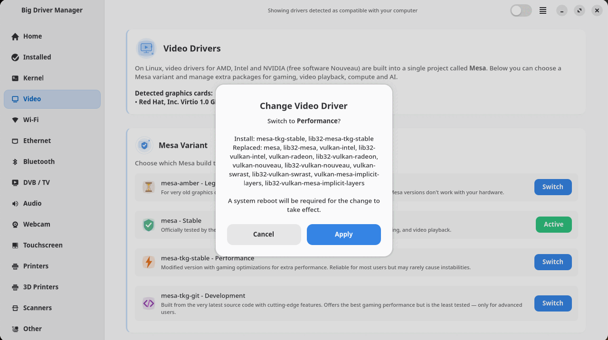

<p align="center">
  
</p>

<h1 align="center">Big Driver Manager</h1>

<p align="center">
  Drivers, kernels and Mesa for <a href="https://www.biglinux.com.br/">BigLinux</a> and BigCommunity —
  from a GTK&nbsp;4 interface or from the terminal.
</p>

<p align="center">
  <a href="https://github.com/biglinux/biglinux-driver-manager/actions/workflows/build-package.yml"></a>
  
  
  
  
  
  
  <a href="biglinux-driver-manager/LICENSE"></a>
  <a href="big-driver-manager-cli/LICENSE"></a>
</p>

<p align="center">
  <a href="#features">Features</a> ·
  <a href="#command-line-big-drivers">Command line</a> ·
  <a href="#safe-mesa-switching">Safe Mesa switching</a> ·
  <a href="#architecture">Architecture</a> ·
  <a href="#installation">Installation</a> ·
  <a href="#development">Development</a>
</p>

---

<p align="center">
  
</p>

## Overview

**Big Driver Manager** finds out what hardware a machine has and installs what it
needs: graphics drivers (NVIDIA, Mesa variants, virtual machine tools), kernels
together with their modules, firmware, and drivers for Wi-Fi, printers, scanners
and other devices.

It ships as **two packages built from this repository**:

| Package | What it is |
|---|---|
| [`biglinux-driver-manager`](biglinux-driver-manager/README.md) | The GTK 4 / libadwaita interface. It only draws: everything that changes the system is delegated to the command line. |
| [`big-driver-manager-cli`](big-driver-manager-cli/README.md) | The core and the command line, `big-drivers`: hardware detection, the driver database and every privileged operation. No graphical dependencies — it runs in the live session, in the installer and at boot. |

One PKGBUILD builds both, so the interface and the core it imports always ship
the same version.

## Screenshots

| Kernels | Installed drivers |
|---|---|
|  |  |
| **Mesa variants** | **Switching Mesa: the plan, before anything runs** |
|  |  |

## Features

### Graphics
- **Automatic driver selection** — detects every display controller and picks the
  right driver: the NVIDIA branch from NVIDIA's own support list (current, 580xx,
  470xx, or nouveau), the matching module package for every installed kernel,
  and guest tools on VirtualBox, VMware and QEMU/KVM.
- **Hybrid laptops** — `hybrid`, `nvidia` or `integrated` GPU modes, with
  PRIME, RTD3 power management and display-manager integration.
- **Black-screen protection** — if the proprietary driver does not bring up a
  login screen, the card falls back to nouveau before the user is left without
  a display.
- **Mesa variants** — switch between Stable, Tkg-Stable, Tkg-git and Amber
  without removing anything that depends on Mesa (see
  [Safe Mesa switching](#safe-mesa-switching)).

| Variant | Package | For |
|---|---|---|
| Stable *(recommended)* | `mesa` | Everyday use, gaming and video playback |
| Performance | `mesa-tkg-stable` | Gaming optimizations on top of the stable release |
| Development | `mesa-tkg-git` | The latest Mesa source — advanced users only |
| Legacy | `mesa-amber` | Very old GPUs limited to OpenGL 2.1 |

### Kernels
- Lists the kernels in the repositories — LTS, standard, real-time, XanMod,
  CachyOS — with the running and installed ones marked.
- Installs a kernel **together with its headers and every module the running
  kernel uses** (NVIDIA, Broadcom Wi-Fi, VirtualBox…), so a new kernel never
  boots without its drivers.
- Never removes the running kernel; reports installed kernels that left the
  repositories.

### Devices
- Wi-Fi, Ethernet, Bluetooth, DVB/TV, audio, webcams, touchscreens, printers,
  3D printers and scanners, matched by PCI/USB/SDIO device IDs.
- Firmware packages and an *Installed* view grouped by category.

### Everywhere
- **One password prompt per operation**, through polkit.
- **Translated** into 32 locales: the interface, the command line and the
  polkit prompts.
- **Accessible output**: colors only on a terminal; plain English for logs,
  pipes and the interface.

## Command line: `big-drivers`

`big-drivers` (also installed as `big-driver-manager-cli`) does from the
terminal what the interface does — and is what the interface itself runs, as
root, for every change. Run as a normal user, it shows what it will do, asks
for confirmation and requests the password through polkit.

```console
$ big-drivers --help
usage: big-drivers [-h] [--version] [--color {auto,always,never}] COMMAND ...

positional arguments:
  COMMAND
    kernel              list, install and remove kernels with their modules
    gpu                 graphics drivers (replaces mhwd)
    mesa                switch between the Mesa variants (stable, tkg, amber)
    install             install packages from the repositories
    remove              remove packages
    mhwd                install or remove an mhwd configuration
```

### Quick reference

| Task | Command |
|---|---|
| Kernels in the repositories | `big-drivers kernel list` |
| Installed kernels (JSON for scripts) | `big-drivers kernel list --installed --json` |
| Install a kernel with its headers and modules | `big-drivers kernel install linux-big` |
| Remove a kernel and its modules | `big-drivers kernel remove linux612` |
| Graphics cards and their drivers | `big-drivers gpu` |
| Install the drivers this machine needs | `big-drivers gpu install` |
| Choose the GPU on a hybrid laptop | `big-drivers gpu mode hybrid\|nvidia\|integrated` |
| Mesa variants, the one in use marked | `big-drivers mesa list` |
| What a Mesa switch would do (no root) | `big-drivers mesa plan tkg-stable` |
| Switch the Mesa variant | `big-drivers mesa apply tkg-stable` |

Add `-y`/`--yes` to skip the confirmation in scripts. `mhwd-kernel`'s options
(`-l`, `-li`, `-i NAME`, `-r NAME`) keep working.

### Examples

```console
$ big-drivers kernel list --installed
Installed kernels
─────────────────
     Kernel    Version    Repository
  ●  linux618  6.18.49-1  core        running · LTS

$ big-drivers mesa list
     Variant     Package
  ○  amber       mesa-amber
  ●  stable      mesa             in use
  ○  tkg-stable  mesa-tkg-stable
  ○  tkg-git     mesa-tkg-git

$ big-drivers mesa plan tkg-stable
Switch Mesa to Tkg-Stable
─────────────────────────
  Install:
    mesa-tkg-stable lib32-mesa-tkg-stable
  Replaced:
    mesa lib32-mesa vulkan-intel lib32-vulkan-intel vulkan-radeon lib32-vulkan-radeon …
```

The full reference — GPU decisions, hybrid modes, services, the installer
options (`--root`, `--pmconfig`) and exit codes — is in
[big-driver-manager-cli/README.md](big-driver-manager-cli/README.md).

## Safe Mesa switching

Every package on a desktop depends on Mesa, directly or not. A switch therefore
**replaces** the old variant; it never removes it on its own first.

1. **Plan** — before anything runs, pacman's metadata decides what the new
   variant replaces. The switch is refused, with the reason, when a package
   that stays installed would lose a dependency (for example, `mesa-amber`
   does not provide `libva-mesa-driver`, which `biglinux-vaapi` needs) or when
   the 32-bit twin of the variant is missing.
2. **Download** — the new packages are downloaded first (`pacman -Sw`), so a
   network failure cannot happen half-way.
3. **Replace** — one transaction (`pacman -S --needed --ask 4`) installs the new
   variant and removes what it conflicts with. Its provides (`mesa`,
   `vulkan-intel`, …) keep every dependent satisfied, and pacman refuses the
   whole transaction — changing nothing — if a dependency would break.
4. **Roll back** — the few old packages the new variant does not declare a
   conflict with are removed just before step 3 and put back, with their
   install reason, if it fails.

Removing in cascade (`pacman -Rc`) is not possible through the privileged
interface at all.

## Architecture

```
┌──────────────────────────────┐
│  biglinux-driver-manager     │  GTK 4 / libadwaita interface
│  (ui/, utils/, icons)        │  imports core/ read-only
└──────────────┬───────────────┘
               │  pkexec big-driver-manager-cli <verb>
               │  polkit action: br.com.biglinux.drivermanager.cli
               ▼
┌──────────────────────────────┐
│  big-driver-manager-cli      │  validates every request, then runs
│  core/  assets/  big-drivers │  pacman or mhwd — nothing else
└──────────────────────────────┘
```

- The interface never asks polkit for pacman itself. It asks for one of a few
  verbs, and the command line refuses anything outside that list before pacman
  or mhwd runs. Package names are validated so they can never become options.
- The live session and the installer, already root, use the same command.
- systemd services run `gpu boot` before the display manager, install drivers
  on live media and guard against a display manager that never comes up.

## Installation

On BigLinux, install the interface from the repositories; it depends on the
command line, which pacman installs with it:

```bash
sudo pacman -S biglinux-driver-manager    # interface + command line
```

`big-driver-manager-cli` can also be installed on its own where there is no
desktop (servers, scripts, the installer).

Open **Big Driver Manager** from the application menu, or run
`big-driver-manager`.

### Building from source

```bash
git clone https://github.com/biglinux/biglinux-driver-manager.git
cd biglinux-driver-manager/pkgbuild
makepkg -si          # builds and installs both packages
```

The PKGBUILD builds the branch in `BIGLINUX_GIT_BRANCH` (default `main`).
Releases are built by the [build-package](.github/workflows/build-package.yml)
workflow and published with [gitrepo](https://github.com/big-comm/gitrepo).

## Development

### Requirements

Python 3.10+, PyGObject, GTK 4, libadwaita, pytest and ruff.

### Tests and lint

```bash
(cd big-driver-manager-cli && python -m pytest)
(cd biglinux-driver-manager && \
    BDM_CLI_DIR="$PWD/../big-driver-manager-cli/usr/share/big-driver-manager-cli" \
    python -m pytest)
ruff check . && ruff format --check .
```

`BDM_CLI_DIR` makes the interface's tests import the core from this checkout;
without it, a core installed in `/usr/share/big-driver-manager-cli` takes
precedence. A safety net in the test suites refuses to run pacman, pkexec or
any other command that changes the system.

End-to-end tests of the GPU flow run against the real pacman in a throwaway
container — never on a real system; see
[big-driver-manager-cli/README.md](big-driver-manager-cli/README.md#development).

### Translations

Messages use GNU gettext. The command line has its own domain
(`big-driver-manager-cli`); after changing a message, run:

```bash
big-driver-manager-cli/scripts/update-translations.sh
```

It refreshes the template, merges every catalog, compiles the `.mo` files and
updates the polkit policy's translations. The tests require every catalog to
be complete and to keep each message's placeholders.

### Repository layout

```
.
├── big-driver-manager-cli/      core, command line, assets, services, polkit policy
├── biglinux-driver-manager/     GTK interface, icons, desktop entry
├── pkgbuild/                    PKGBUILD for both packages
├── docs/screenshots/            images used in this README
└── .github/workflows/           package build
```

## Contributing

Issues and pull requests are welcome at
[github.com/biglinux/biglinux-driver-manager](https://github.com/biglinux/biglinux-driver-manager).
Please run the tests and `ruff` before opening a pull request, and keep the
translations complete when changing messages.

## License

- Interface (`biglinux-driver-manager`): [MIT](biglinux-driver-manager/LICENSE)
- Core and command line (`big-driver-manager-cli`): [GPL-3.0-or-later](big-driver-manager-cli/LICENSE)
